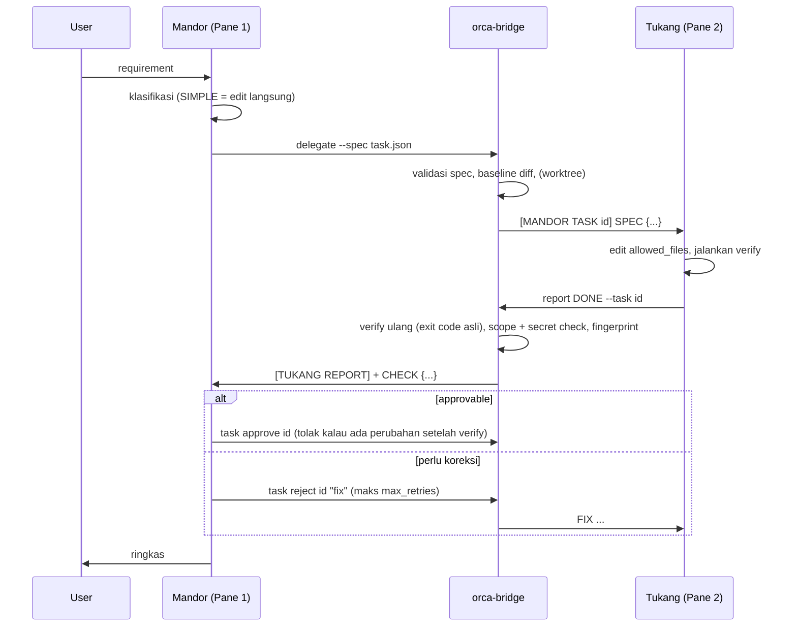

# Audit & Perubahan v0.2.0

Baseline audit: commit `716364c` (v0.1). Line refs `old:` menunjuk file di commit itu.

## A. Temuan terverifikasi

| # | Sev | File (old) | Temuan | Solusi |
|---|---|---|---|---|
| 1 | P0 | `orca-bridge.sh:43-52,63-72` | Routing jatuh ke `pool[0]` / `pool[1]` (urutan array) kalau judul tidak cocok; regex fallback `/omp\|claude\|pi/` cocok dengan path seperti `annnpii`. Pesan bisa nyasar ke shell lain. | Binding handle (`pair bind`, ditulis `orca-pair`), title match hanya kalau unik, split layout Orca sebagai fallback terakhir, selain itu error + daftar kandidat. Self-send ditolak. |
| 2 | P0 | `orca-bridge.sh:131-132` | `wait` selalu `|| true` lalu cetak "is ready / idle!" walau timeout. | Exit 1 + pesan "NOT confirmed idle". |
| 3 | P0 | `orca-bridge.sh:99,159,183` | Kegagalan `orca terminal send` tidak dicek kecuali lewat `set -e` tanpa pesan; delegate tidak punya state, jadi gagal kirim = hilang. | `deliver()` cek exit, task jadi FAILED, `task resume` kirim ulang. |
| 4 | P0 | `orca-bridge.sh:149-150` | Delegate menyuruh Tukang "Verifikasi dengan 'npm test'", bertabrakan dengan Verify Command dari Mandor. | Dihapus; verify command dari spec, deteksi otomatis multi-tooling, tidak terdeteksi = ditolak. |
| 5 | P0 | `AGENTS.md`, `GEMINI.md` | Allowlist & no-self-approve hanya di prompt. `report` meneruskan klaim Tukang mentah, tidak ada cek diff/exit code. | Bridge menjalankan verify sendiri, cek diff vs allowlist + pola sensitif (termasuk `.env` yang di-gitignore), fingerprint isi file; approve menolak kalau gagal. |
| 6 | P0 | (tidak ada) | Perubahan yang ditolak tetap di working tree tanpa jejak. | `isolate: true` (git worktree, patch masuk saat approve); mode shared punya baseline + `task revert` yang memulihkan isi file pra-task (termasuk WIP user). |
| 7 | P1 | `orca-pair.sh:21-66` vs `AGENTS.md` | Template AGENTS.md inline sudah drift: tidak memuat Anti-Handoff-Leak contract yang jadi inti repo. | `orca-pair` menyalin `AGENTS.md` kanonik; isi unik template (browser protocol, dual-persona, daftar skill) dipindah ke kanonik. |
| 8 | P1 | `orca-pair.sh:108-111` | `graphify a && b && c >/dev/null &`: output dua perintah pertama bocor ke terminal. | Seluruh rantai dibungkus `bg bash -c ...` dengan redirect penuh. |
| 9 | P1 | `orca-pair.sh:13-17` | Setelah `orca open` + `sleep 2`, runtime tidak dicek ulang. | Retry 10 detik, gagal = exit 1. |
| 10 | P1 | (tidak ada) | Tidak ada task ID, state, log, retry limit; anti-ronde-loop hanya teks. | State machine + `max_retries` (default 1) ditegakkan bridge. |
| 11 | P1 | `CLAUDE.md:22-25` | Handoff = teks bebas; tidak ada validasi field wajib. | Spec JSON tervalidasi; format lama tetap jalan tapi wajib `Allowed Files:` + `Verify Command:`. |
| 12 | P2 | `install.sh:15-16` | `cp` ke `~/.local/bin/orca-bridge` mengikuti symlink: di mesin ini akan menimpa `Curabeauty/scripts/orca-bridge.sh`. | Symlink di-backup sebagai symlink lalu diganti file biasa; uninstall memulihkan. |
| 13 | P2 | `install.sh:20` | `cp -r ROOT/* SKILLS_DIR || true`: error ditelan; README menyuruh clone langsung ke `SKILLS_DIR`, jadi copy ke diri sendiri; edit user ditimpa. | Deteksi ROOT == SKILLS_DIR, manifest checksum, file yang diedit user disimpan + versi baru `.new`, `--force`. |
| 14 | P2 | `install.sh` | Tidak ada cek dependency, versi, backup, rollback, uninstall. | Semua ditambahkan + validasi pasca-install (`orca-bridge version`). |
| 15 | P2 | `README.md:3`, `SKILL.md:8` | Klaim ">85%" tanpa benchmark. | Dihapus; diganti target + framework benchmark. |
| 16 | P2 | `README.md`, `SKILL.md`, `CLAUDE.md`, `GEMINI.md` | Contract yang sama ditulis ulang 4x dengan detail berbeda (GEMINI minta commit hash, AGENTS tidak). | AGENTS.md jadi sumber kebenaran; CLAUDE/GEMINI hanya aturan khusus peran + rujukan. |

Tidak terbukti bermasalah: perintah `browser` dan `worktree` (dipertahankan apa adanya, kecuali screenshot gagal sekarang exit non-zero).

## B. File yang berubah
- `scripts/orca-bridge.sh`: routing deterministik, `wait`/`send` jujur, task lifecycle, verify, scope, isolation, tracker, `pair`, `detect-verify`, `version`. Perintah lama (`send read wait delegate report browser worktree status`) tetap ada.
- `scripts/mandor-lib.js` (baru): validasi spec, resolver terminal, scope glob, record-check, usage collector/report.
- `scripts/orca-pair.sh`: AGENTS.md dari kanonik, bind handle, readiness wait, retry Orca, bg indexer senyap. Override `MANDOR_CMD`/`TUKANG_CMD`/`MANDOR_HOME`.
- `scripts/install.sh`: lifecycle lengkap.
- `AGENTS.md`, `CLAUDE.md`, `GEMINI.md`, `SKILL.md`, `README.md`: lihat bagian H.
- Baru: `VERSION`, `CHANGELOG.md`, `tests/`, `bench/`, `docs/AUDIT.md`, `rules/mandor.md` + `rules/tukang.md` (blok global omp/agy via `install.sh --global-rules`).

## C. Efisiensi token: mekanismenya
1. **Handoff padat**: satu header + `SPEC` JSON minified + 3 baris aturan. Tidak ada salinan AGENTS.md atau penjelasan berulang. Ukuran tiap handoff dicatat (`handoff_tokens_est`).
2. **Review tanpa eksplorasi ulang**: laporan Tukang datang dengan `CHECK` (file berubah, scope, exit code, diffstat). Mandor tidak perlu menjalankan test atau membaca repo untuk memutuskan; `task diff` hanya kalau ragu, per file.
3. **Log test tidak masuk konteks** kecuali gagal (15 baris terakhir).
4. **Loop dibatasi mesin**, bukan niat: `max_retries` default 1, reject wajib berisi koreksi spesifik, retry ke-n+1 = REJECTED.
5. **SIMPLE tidak didelegasikan** (bridge menolak tanpa `--force`): handoff + review lebih mahal daripada edit langsung.
6. **Recovery murah**: `task resume` mengirim ulang spec yang sama; tidak ada planning ulang oleh model mahal.
7. **Instruksi tidak dobel**: project hanya memuat `AGENTS.md` (CLAUDE/GEMINI symlink); detail peran dibaca on-demand dari folder skill.

Data nyata dari tracker (bukan benchmark): sesi audit ini, 29 call Opus dalam 10 menit = 58 input + 6.459.891 cache-read + 59.962 cache-write + 45.191 output token, $2,68 (omp, `actual`). Cache-read mendominasi, jadi memperkecil konteks Mandor per call lebih berdampak daripada memangkas output.

## D. Benchmark
- **Terukur**: belum ada perbandingan single vs pair. Harness diuji end-to-end (`bench/run.sh simple single`: task dibuat, check exit 0, approved, `usage compare` keluar tabel), tapi angkanya dari input manual `estimated`, bukan run model.
- **Belum dibenchmark**: semua skenario dengan model sungguhan. Usage Antigravity tidak tersedia otomatis (store-nya protobuf internal), jadi baris pair akan bertanda `+incomplete` sampai diisi manual.

## E. Testing
| Perintah | Exit | Hasil |
|---|---|---|
| `bash tests/run.sh` | 0 | 139 passed, 0 failed (32 skenario: routing, wait/send, spec, verify detection, lifecycle, scope, secrets, baseline, retry, isolation, recovery, lock, usage, orca-pair, install/upgrade/uninstall/rollback) |
| `orca-bridge.sh status` di Orca asli | 0 | Mandor via title, Tukang via split layout (handle sama dengan versi lama) |
| `mandor-lib.js usage-omp` pada session omp asli | 0 | usage `actual` terbaca |
| `bench/run.sh simple single` + check + approve | 0 | fixture gagal sebelum fix (`npm test` exit 1), lolos sesudahnya |

## F. Sisa masalah
| Prioritas | Masalah |
|---|---|
| P1 | Bridge tidak men-sandbox proses agent. Pelanggaran terdeteksi dan diblok di approve, tapi tidak dicegah. Tukang juga bisa mengedit file state di `~/.local/state`. Solusi penuh butuh sandbox di sisi agent (`agy --sandbox`) atau user OS terpisah. |
| P1 | Mode shared: edit Mandor sendiri di tree yang sama selama task berjalan ikut terhitung sebagai perubahan Tukang. Pakai `isolate` untuk task panjang. |
| P2 | Usage Antigravity belum bisa diambil otomatis. |
| P2 | Atribusi usage omp berbasis jendela waktu per project; kerja lain di project yang sama selama task ikut terhitung. |
| P2 | `isolate` memakai HEAD: perubahan uncommitted di tree utama tidak ikut ke worktree. |

## G. Alur akhir

## H. Catatan perubahan instruksi
Tidak ada skill atau kemampuan yang dihapus. `skills/*.md` tidak diubah.

| File | Ditambah | Diubah | Dihapus |
|---|---|---|---|
| `AGENTS.md` | Poin 5 enforcement bridge, spec JSON, tabel klasifikasi, routing deterministik, dual-persona, daftar skill, §8 browser protocol (dari template `orca-pair`), `gitnexus impact` | Perintah komunikasi pakai `--spec`/`--task`; anti-ronde-loop mengacu `CHECK approvable` + `max_retries`; Pane 2 memuat migrasi DB & browser audit (dari template) | Tidak ada |
| `CLAUDE.md` | Tabel klasifikasi, format spec, protokol approve 5 langkah, recovery, §4 token tracker | Contoh delegasi utama jadi `--spec` (format lama tetap tercantum) | Tidak ada |
| `GEMINI.md` | Format pesan task, `WORKDIR`, catatan bridge cek diff/verify ulang, tunggu RESUME saat BLOCKED, jangan tempel log test penuh | Report pakai `--task`; "npm test" jadi Verify Command dari Mandor | Kewajiban commit hash di report (bridge sekarang melampirkan bukti; format lama tetap diterima) |
| `SKILL.md` | Paragraf enforcement, langkah 5 tracker | Klaim ">85%" jadi target + rujukan benchmark; review gate pakai `CHECK` | Klaim angka tanpa data |
| `README.md` | Diagram state, daftar perintah baru, info install/uninstall, struktur baru | Klaim ">85%" | Klaim angka tanpa data |
| template `orca-pair` | (dipindah ke `AGENTS.md`) | `orca-pair` menyalin `AGENTS.md` kanonik | Heredoc template (isinya dipertahankan di `AGENTS.md`) |
| `rules/mandor.md` (global omp) | Semua poin section "Orca Dual-Engine Multi-Agent" lama di `~/.omp/agent/RULES.md` + klasifikasi, spec, protokol gate, recovery, token | Approve: dari "`npm test` lolos" jadi `CHECK approvable` + kriteria; delegasi jadi spec JSON (format lama tetap disebut) | Tidak ada |
| `rules/tukang.md` (global agy) | Peran Tukang, format task, boundary, report/BLOCKED, browser, disiplin | (baru; `~/.gemini/GEMINI.md` sebelumnya tidak punya aturan Orca) | Tidak ada |
